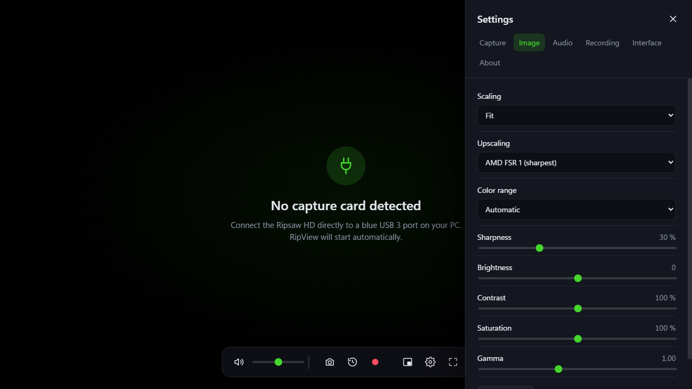
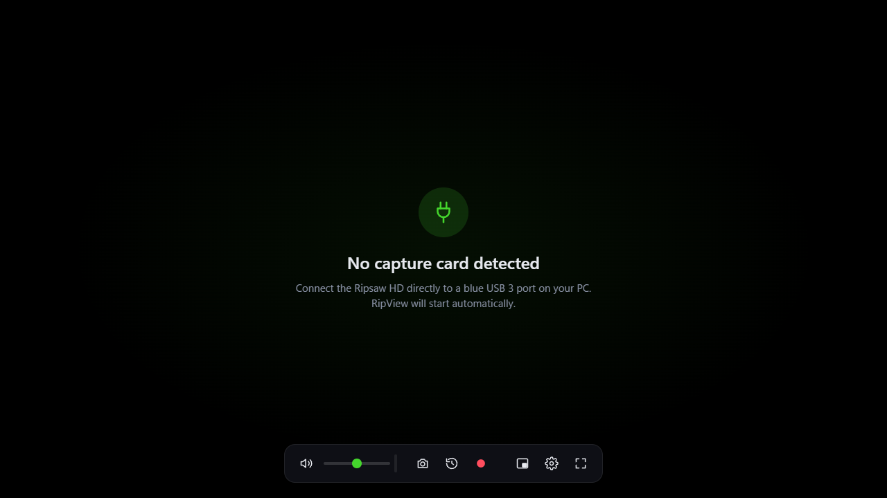

<div align="center">
  

# RipView · Razer Ripsaw HD Viewer

**Free, low-latency capture card viewer to play your PS5, PS4, Xbox or Nintendo Switch on your PC through a Razer Ripsaw HD, in 1080p60, without OBS or Streamlabs.**

[](https://github.com/Nekuzaky/ripsaw-hd-viewer/actions/workflows/ci.yml)
[](#installation)
[](#features)
[](LICENSE)

[Français](#français) · [Download](https://github.com/Nekuzaky/ripsaw-hd-viewer/releases/latest)

</div>

---

<p align="center">
  
  
</p>

## Features

**Image**

- 1080p at 60 fps, the highest capture mode of the Ripsaw HD, rendered on the GPU through WebGL2
- **AMD FidelityFX Super Resolution 1** (EASU upscaling + RCAS sharpening) keeps the 1080p capture crisp on 1440p and 4K monitors
- Automatic detection and correction of limited color range (16-235), the usual cause of washed-out blacks
- Brightness, contrast, saturation and gamma controls
- Fit, fill and stretch scaling

**Reliability**

- Detects the Ripsaw HD automatically and ignores webcams
- Reconnects on its own when the card is unplugged, the console turns off or another app releases the device
- Detects corrupted frames (green bands caused by USB bandwidth issues) and low frame rates, then lowers the capture quality and tells you how to fix it
- Clear messages when the card is busy (OBS, Streamlabs, Discord), missing or receiving no signal

**Audio**

- Console audio routed through Web Audio with the lowest latency mode
- Echo cancellation, noise suppression and auto gain disabled for clean game audio
- Night mode: a compressor that tames explosions and lifts dialogue
- Lip-sync offset and output device selection

**Capture**

- Screenshots in full resolution PNG, with your image settings applied
- Instant replay: save the last 10 to 120 seconds with one key
- Recording to MP4 (H.264 + AAC) streamed straight to disk
- Files saved in `Videos\RipView`

**Comfort**

- Mini player: a small always-on-top window in the corner of your screen
- Auto-hiding controls and cursor
- Keeps the screen awake while you play
- English and French interface
- Automatic updates: new versions download in the background and install on restart

## Keyboard shortcuts

| Key          | Action                            |
| ------------ | --------------------------------- |
| `F` / `F11`  | Fullscreen                        |
| `Esc`        | Exit fullscreen or close settings |
| `M`          | Mute                              |
| `↑` / `↓`    | Volume                            |
| `S` / `F12`  | Screenshot                        |
| `B`          | Save instant replay               |
| `R`          | Start / stop recording            |
| `P`          | Mini player                       |
| `Z`          | Cycle scaling mode                |
| `I`          | Performance stats and latency     |
| `Tab`        | Settings                          |
| `F5`         | Reconnect                         |
| Double-click | Fullscreen                        |

## Getting the best image

1. Plug the Ripsaw HD **directly into a USB 3 port** on your PC. USB 2 ports and hubs do not have enough bandwidth for 1080p60 and cause green or yellow glitches.
2. On a PS5, open **Settings › System › HDMI** and turn off **Enable HDCP**. Without this, the image stays black.
3. Turn off **HDR** on the console: the Ripsaw HD captures SDR only.
4. Set the console output to **1080p** or **Automatic**. The Ripsaw HD passes 4K through its HDMI output but captures at 1080p.
5. Close any other app that uses the card (OBS, Streamlabs, Discord, Razer Synapse preview).

If you have a TV or monitor plugged into the Ripsaw HD output, it receives the signal directly in 4K with zero added latency.

## Installation

Download the installer or the portable version from the [latest release](https://github.com/Nekuzaky/ripsaw-hd-viewer/releases/latest).

Requirements: Windows 10 or 11 (64-bit), a Razer Ripsaw HD and a USB 3 port. Other UVC HDMI capture cards can be selected in **Settings › Capture**.

## FAQ

**How do I play my PS5 on my PC with a Razer Ripsaw HD without OBS or Streamlabs?**
Install RipView, plug the Ripsaw HD into a USB 3 port and open the app. It finds the card, the console audio and starts in 1080p60 on its own.

**Why is my Ripsaw HD showing a black screen?**
HDCP is enabled on the console. On a PS5, turn off **Settings › System › HDMI › Enable HDCP**.

**Why are there green or yellow lines on the image?**
The card does not get enough USB bandwidth. Plug it directly into a USB 3 port on the back of the PC, not into a hub or a USB 2 port. RipView detects this and lowers the quality until it is fixed.

**Why do the colors look washed out?**
The console sends a limited color range. RipView corrects it automatically, or you can force it in **Settings › Image › Color range**.

**Does the Ripsaw HD capture in 4K?**
No. It passes 4K through to a TV or monitor plugged into its HDMI output, but it captures at up to 1080p60. RipView uses that maximum.

**How much delay does RipView add?**
Video is drawn the moment each frame arrives, and audio uses the lowest-latency mode of Windows. Press `I` to see the measured video latency inside the PC (typically around 25 ms), the audio latency, the frame rate and dropped frames.

**The Ripsaw HD is "in use by another app". What should I do?**
Close OBS, Streamlabs, Discord or any app with a camera preview. RipView reconnects automatically.

## Development

```bash
npm install
npm run dev
```

| Script           | Description                              |
| ---------------- | ---------------------------------------- |
| `npm run dev`    | Start the app with hot reload            |
| `npm run build`  | Type-check and build                     |
| `npm run lint`   | Lint with ESLint                         |
| `npm run format` | Format with Prettier                     |
| `npm run dist`   | Build the Windows installer and portable |

### Architecture

```
src/
├── main/                 Electron main process
│   ├── index.ts          App lifecycle, permissions, single instance
│   ├── MainWindow.ts     Window, fullscreen and mini player
│   ├── SettingsStore.ts  Persistent settings (atomic JSON writes)
│   ├── MediaStorage.ts   Screenshots, replays and streamed recordings
│   └── registerIpc.ts    Typed IPC handlers
├── preload/              Context-isolated bridge exposed as window.ripview
├── shared/               Types shared by every process (IPC, settings)
└── renderer/src/
    ├── app/              Orchestration and user actions
    ├── capture/          Device discovery, quality profiles, reconnection
    ├── render/           WebGL2 renderer and shaders
    ├── health/           Frame rate, corruption and color range analysis
    ├── audio/            Low-latency audio graph
    ├── record/           Recorder, instant replay buffer, codec selection
    ├── ui/               Control bar, settings, status screen, toasts
    ├── input/            Keyboard shortcuts
    ├── i18n/             Translations
    └── core/             Event emitter and settings service
```

The renderer runs sandboxed with context isolation. The main process only exposes a narrow, typed API through the preload script.

## Contributing

Issues and pull requests are welcome. See [CONTRIBUTING.md](CONTRIBUTING.md).

## Support

If RipView helps you, you can [sponsor the project](https://github.com/sponsors/Nekuzaky).

## License

[MIT](LICENSE)

RipView is an independent project. It is not affiliated with, endorsed by or sponsored by Razer Inc. or Sony Interactive Entertainment. Razer and Ripsaw are trademarks of Razer Inc.

---

## Français

**RipView** est un logiciel gratuit pour la carte de capture **Razer Ripsaw HD**. Il affiche ta PS5, PS4, Xbox ou Nintendo Switch sur ton PC avec la meilleure image possible et la latence la plus faible, sans OBS ni Streamlabs.

- **Image** : 1080p à 60 i/s rendue par la carte graphique, agrandissement AMD FSR 1 pour les écrans 1440p et 4K, correction automatique des couleurs délavées, réglages de luminosité, contraste, saturation et gamma.
- **Fiabilité** : détection automatique de la Ripsaw HD, reconnexion toute seule, détection des glitchs USB avec baisse automatique de la qualité et conseil pour régler le problème.
- **Son** : latence minimale, mode nuit, réglage de synchro, choix de la sortie.
- **Captures** : captures d'écran, replay instantané (touche `B`), enregistrement MP4 dans `Vidéos\RipView`.
- **Confort** : mini-lecteur toujours au premier plan (touche `P`), interface qui se cache toute seule, écran qui ne se met pas en veille, mises à jour automatiques.

**Pour la meilleure image** : branche la Ripsaw HD directement sur un port USB 3 (pas sur un hub), désactive le HDCP et le HDR dans les réglages de la PS5, et ferme OBS, Streamlabs ou Discord.

[Télécharger la dernière version](https://github.com/Nekuzaky/ripsaw-hd-viewer/releases/latest)
